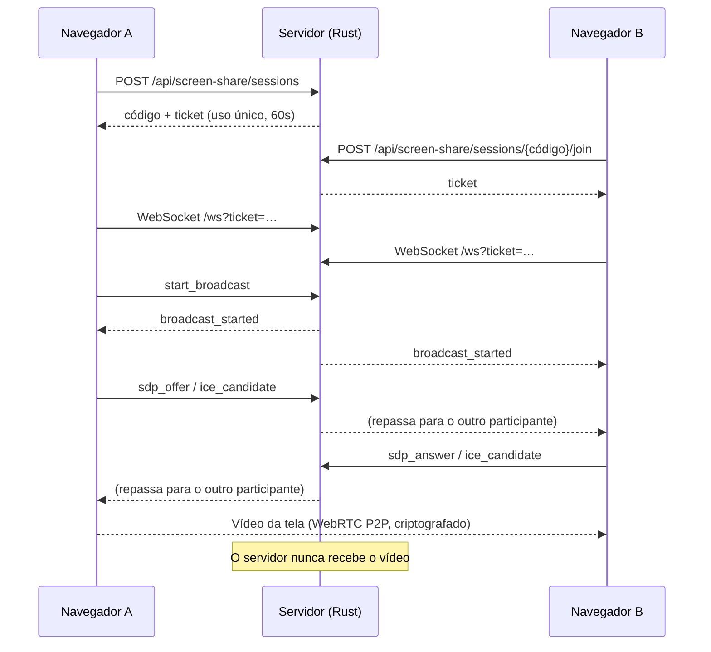

# Éris Screen Share — demo aberta

Cópia **pública e funcional** do serviço de compartilhamento de tela da **Éris API** (DSA Digital).

Este repositório existe para que qualquer pessoa possa auditar como o recurso funciona e comprovar que ele **não captura, grava, armazena ou analisa** o conteúdo da tela de ninguém.

> O servidor apenas *apresenta* os dois navegadores. A imagem da tela vai **direto** de um participante para o outro, via WebRTC, criptografada ponta a ponta (DTLS-SRTP). Ela nunca passa pelo servidor.

---

## Como rodar

Requisitos: [Rust](https://rustup.rs) 1.85+ (edition 2024) e um navegador moderno (Chrome, Edge, Firefox).

```bash
cargo run
```

1. Abra `http://127.0.0.1:8080` em **duas abas** (ou dois navegadores).
2. Na primeira, informe um nome e clique em **Criar nova sessão**.
3. Na segunda, informe outro nome, digite o código de 8 caracteres e clique em **Entrar**.
4. Clique em **Compartilhar minha tela** em qualquer uma delas.
5. Acompanhe no painel **Log de sinalização** cada mensagem trocada com o servidor.

Variáveis de ambiente opcionais:

| Variável   | Padrão      | Descrição                     |
| :--------- | :---------- | :---------------------------- |
| `HOST`     | `127.0.0.1` | Interface de rede do servidor |
| `PORT`     | `8080`      | Porta HTTP                    |
| `RUST_LOG` | `info`      | Nível de log                  |

### Testes

```bash
cargo test
```

São os mesmos 10 testes da máquina de estados de produção (`src/manager.rs`), mais um teste do fluxo HTTP.

### Redes diferentes (opcional)

Por padrão a página **não usa nenhum servidor STUN/TURN**, para não fazer requisições a terceiros. Assim, a conexão funciona na mesma máquina ou na mesma rede local. Para conectar redes diferentes, informe um STUN seu explicitamente:

```
http://SEU_HOST:8080/?stun=stun:stun.exemplo.com:3478
```

---

## Arquitetura



| Arquivo | Origem em produção | Diferença |
| :--- | :--- | :--- |
| [`src/manager.rs`](src/manager.rs) | `src/services/screen_share/manager.rs` | **Cópia fiel**: só muda o caminho de import |
| [`src/handlers/ws_signaling.rs`](src/handlers/ws_signaling.rs) | `src/services/screen_share/services/ws_signaling.rs` | **Cópia fiel**: só mudam os imports e a macro de log |
| [`src/schemas.rs`](src/schemas.rs) | `src/schemas/screen_share.rs` | Mesmos contratos JSON, sem anotações do Swagger |
| [`src/handlers/*.rs`](src/handlers) | `src/services/screen_share/services/*.rs` | Sem banco de dados (veja abaixo) |
| [`src/identity.rs`](src/identity.rs) | `middlewares/authenticated_user.rs` | Identidade descartável no lugar de login via JWT |
| [`static/`](static) | Frontend DSA Digital | Cliente mínimo em JS puro, para demonstração |

Toda diferença em relação à produção está marcada no código com `[DEMO]`.

---

## Transparência de dados

### O que trafega pelo servidor

- Nome de exibição e um ID aleatório (UUID v4), apenas em memória.
- Código da sessão, quem está conectado e quem está transmitindo.
- Mensagens de controle (`start_broadcast`, `request_swap`, …).
- Sinalização WebRTC: SDP (descrição de codecs) e candidatos ICE (endereços de rede necessários para a conexão P2P). Essas mensagens são repassadas **exclusivamente** ao outro participante da mesma sessão.

### O que **nunca** trafega pelo servidor

- Imagens, vídeo ou áudio da tela.
- Cookies, `localStorage`, analytics ou fingerprinting.
- Requisições a CDNs, fontes ou qualquer domínio de terceiros. A página é servida com uma `Content-Security-Policy` restrita a `'self'` (veja [`src/main.rs`](src/main.rs)).

### O que é registrado

- **Nesta demo**: nada é persistido. Os logs de acesso registram apenas método, rota, status e duração. **Não registram IP, user-agent nem referer.**
- **Em produção (Éris API)**: além do estado em memória, cada sessão gera **um registro de auditoria** na tabela `screen_share_sessions` do PostgreSQL, com exatamente estes campos:

  | Coluna | Conteúdo |
  | :--- | :--- |
  | `id`, `code` | Identificadores da sessão |
  | `created_by`, `participant_a`, `participant_b` | IDs dos usuários participantes |
  | `status` | `waiting`, `ready` ou `closed` |
  | `active_broadcaster` | ID de quem está transmitindo (ou nulo) |
  | `created_at`, `ended_at` | Horários de início e fim |

  Nenhum frame, miniatura ou gravação da tela é armazenado.

---

## Regras de negócio preservadas

- No máximo **2 participantes** por sessão. O terceiro recebe `session_full`.
- Só **um** participante transmite por vez. Para trocar, o outro precisa pedir (`request_swap`) e o transmissor precisa aceitar (`respond_swap`).
- Tickets de WebSocket são aleatórios (32 caracteres), de **uso único** e expiram em **60 segundos**.
- Se o transmissor desconectar, a transmissão é interrompida e o outro participante é avisado.
- Ao encerrar a sessão, o código de convite é invalidado e nenhuma ação nova é aceita.

---

## Protocolo WebSocket

Cliente → servidor (`{"action": "...", "payload": {...}}`):
`join`, `start_broadcast`, `stop_broadcast`, `request_swap`, `respond_swap {accept}`, `sdp_offer {sdp}`, `sdp_answer {sdp}`, `ice_candidate {candidate, sdp_mid, sdp_m_line_index}`, `ping`.

Servidor → cliente (`{"event": "...", "payload": {...}}`):
`authenticated`, `session_state`, `participant_joined`, `participant_left`, `broadcast_started`, `broadcast_stopped`, `swap_requested`, `swap_response`, `sdp_offer`, `sdp_answer`, `ice_candidate`, `session_closed`, `error`, `pong`.

---

> ⚠️ Este projeto é uma **demonstração**. A identidade descartável não substitui autenticação real e não há limitação de requisições. Não exponha esta demo publicamente como serviço de produção.
